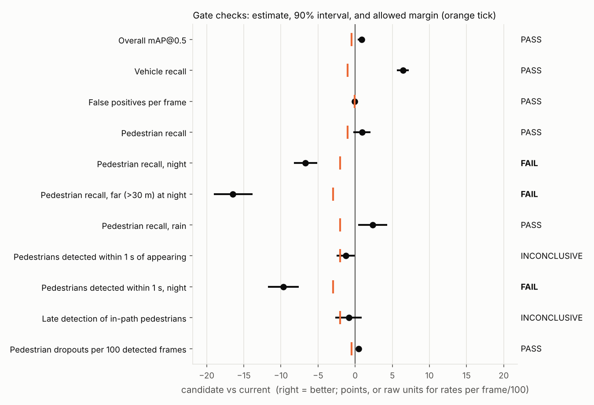
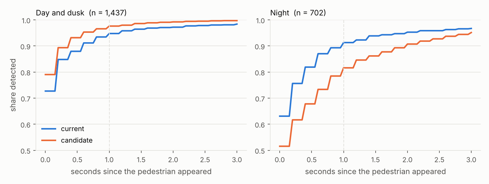

# Perception Release Gate

[](https://github.com/PraneethKorukonda/perception-release-gate/actions/workflows/tests.yml)

Given the object detector a car runs today and a candidate replacement, this
tool runs both on the same driving video and answers one question:
**is the new model safe to ship?** The answer is SHIP, HOLD or NEEDS MORE
DATA, with the evidence behind it.

I built it because the usual way of comparing detectors, one mAP number on a
benchmark, can't answer that question. A model can gain a point of mAP and
still be much worse at seeing a pedestrian 40 m away at night, because there
are relatively few of those boxes and the average barely moves. A
perception team needs to catch exactly that kind of regression before it
ships.

## What it does

```
BDD100K clips ─► ingest ─► run current + candidate ─► match to labels
   (5 fps video,                (YOLO, any model              │
    GPS, scenes)                 that writes the same          ▼
                                 columns)            per-box and per-object tables
                                                               │
                         scenario sets (rules, CLIP) ──────────┤
                                                               ▼
                                           gate checks with clip-level intervals
                                                               │
                                   ┌───────────────┬───────────┴─────────┬──────────────┐
                                   ▼               ▼                     ▼              ▼
                            summary.md       details.md + figures     DuckDB / Spark   dashboard
                          (for the review)                              queries
```

The metrics go past "how many boxes did it find":

| Metric | What it measures | Why it matters |
|---|---|---|
| Frame recall by scenario | Share of labelled boxes found, split by night, rain, distance, occlusion... | Averages hide the scenarios that matter |
| Detected within 1 s | Share of pedestrians found within 1 s of first becoming visible | A late detection is a shorter stopping distance |
| Late in-path detection | In-path pedestrians first seen closer than the car needs to brake comfortably at its GPS speed | Turns detection timing into a driving outcome |
| Dropouts per 100 frames | Times an object is lost and re-found | A downstream tracker sees each one as a coast or a new track |
| False positives per frame | At the deployment threshold | Phantom braking |
| mAP@0.5 | COCO-style, matches pycocotools exactly | The number everyone asks for first |

## Example

`releasegate demo` runs the whole pipeline on 200 simulated clips (the same
size as the BDD100K tracking val split) with three models:

- **current**: the deployed model
- **candidate**: better on average, but I made it worse on far-away pedestrians at night
- **candidate_good**: a plain improvement

Current vs candidate:

| Check | Current | Candidate | Change (90% CI) | Allowed | Verdict |
|---|---:|---:|---|---:|---|
| Overall mAP@0.5 | 85.0% | 85.9% | +0.9 pts (+0.3 to +1.2) | -0.5 | PASS (info) |
| Vehicle recall | 72.4% | 78.8% | +6.4 pts (+5.6 to +7.2) | -1.0 | PASS (info) |
| Pedestrian recall | 80.7% | 81.6% | +0.9 pts (-0.2 to +2.1) | -1.0 | PASS |
| Pedestrian recall, night | 77.6% | 70.9% | -6.7 pts (-8.3 to -5.1) | -2.0 | **FAIL** |
| Pedestrian recall, far (>30 m) at night | 61.4% | 45.0% | -16.5 pts (-19.0 to -13.8) | -3.0 | **FAIL** |
| Pedestrians detected within 1 s, night | 91.3% | 81.6% | -9.7 pts (-11.7 to -7.6) | -3.0 | **FAIL** |
| Late detection of in-path pedestrians | 0.9% | 1.7% | +0.9 pts (-0.9 to +2.7) | +2.0 | INCONCLUSIVE |

**Decision: HOLD.** mAP went up and overall pedestrian recall is fine, so a
single-number comparison would have shipped this model. The candidate vs
candidate_good comparison comes out **SHIP**.

The report also lists what to look at next: the clips where the candidate lost
the most pedestrians, any in-path pedestrians it saw too late, and the
weakest slices. Here the top three slices were all small pedestrians at night
(-15 to -18 pts), which is exactly the regression built into the candidate.





These are simulated numbers. They show the tool working end to end and they
are not a claim about any real detector. See [Running on BDD100K](#running-on-bdd100k)
for real data.

## How the gate decides

Each check is a non-inferiority test: "is the candidate worse than the current
model by more than we accept?" The allowed margin is written in
[`default_gate.toml`](src/releasegate/configs/default_gate.toml) before
anyone looks at results.

- **PASS**: the whole 90% interval is better than -margin.
- **FAIL**: the point estimate is worse than -margin *and* the whole interval
  is below zero (confidently worse, by more than allowed).
- **INCONCLUSIVE**: neither. Usually the scenario is too rare in the eval set
  to tell, which is a dataset problem to fix, not a pass.

Any blocking FAIL means HOLD. Otherwise any blocking INCONCLUSIVE means NEEDS
MORE DATA. Otherwise SHIP.

Two choices worth explaining:

**Intervals resample whole clips, not boxes.** Frames from one 40 s clip share
the road, the light and often the same pedestrians, so 40,000 frames are not
40,000 independent samples. With two identical models, a box-level bootstrap
calls the difference significant far more often than it should
([studies](#does-the-gate-itself-work)). Every check uses the same resampled
clips, so the intervals are consistent with each other.

**A regression in one scenario blocks the release even if the averages
improve.** That's the whole point. A far pedestrian at night is a small share
of the boxes and a large share of the risk.

## Does the gate itself work?

On real data you never learn whether the gate was right. In the simulator I
know the true effect of every check (from a 2,000-clip eval set), so I can run
the gate on many ordinary 200-clip eval sets and count its mistakes.
`releasegate study` does this; full output in
[`reports/studies.md`](reports/studies.md).

| Scenario | Correct call | SHIP | HOLD | NEEDS MORE DATA |
|---|---|---:|---:|---:|
| Better overall, worse on far pedestrians at night | HOLD | 0% | **100%** | 0% |
| Subtle night regression (just past the margin) | HOLD | 0% | **95%** | 5% |
| Noisier frame to frame (more dropouts) | HOLD | 0% | **100%** | 0% |
| Plain improvement | SHIP | **97.5%** | 2.5% | 0% |
| No change at all | SHIP | **15%** | 20% | 65% |

It never shipped a real regression. The last row is the interesting one: with
the candidate *identical* to the current model, the gate usually refused to
say SHIP. Two causes:

1. **Chance.** In the first version a check failed whenever its point
   estimate crossed the margin, and with eight blocking checks one of them
   usually does. Requiring the interval to sit below zero as well cut false
   HOLDs only from 25% to 20%, because the real problem was the second cause.
2. **Too few clips.** With 200 clips, the interval on a night-pedestrian
   check is about as wide as its 2-3 point margin, so the gate can't certify
   it either way. That is what NEEDS MORE DATA is supposed to say.

So the fix is the eval set, not the rule. COCO-pretrained detectors never saw
BDD100K, so its 1,400 training clips are fair evaluation data too. At 600
clips:

| Scenario | Correct call | SHIP | HOLD | NEEDS MORE DATA |
|---|---|---:|---:|---:|
| No change at all | SHIP | **65%** | 0% | 35% |
| Subtle night regression | HOLD | 0% | **100%** | 0% |

False HOLDs drop to zero and the subtle regression is always caught. The
remaining NEEDS MORE DATA would fall further with the full 1,600 clips or
slightly wider margins on the rarest slices. Choosing between those is a
judgment call that belongs to the team, and the study gives them the numbers
to make it.

The same study shows why the intervals resample clips. With two identical
models, a 90% interval should exclude zero 10% of the time:

| Resampling unit | False alarms (should be 10%) | Median interval width |
|---|---:|---:|
| Whole clips | 9% | 1.7 pts |
| Individual boxes | 44% | 0.75 pts |

## Running on BDD100K

You need to download BDD100K yourself (free account at
[bdd-data.berkeley.edu](https://bdd-data.berkeley.edu)): the MOT 2020 images
and labels, and optionally the info files for GPS. Then:

```bash
pip install -e ".[infer,dashboard]"
BDD=~/data/bdd100k ./scripts/run_bdd_val.sh       # yolo11s vs yolo11m by default
streamlit run app/dashboard.py -- --report reports/val --images ~/data/bdd100k/images/track/val
```

On an M1/M2 Mac with `--device mps`, inference at 1280 px takes roughly 30-45
minutes per model for the 200 val clips. Run with `--limit 40` first. Two
settings matter: keep `--conf` low (0.01) because the gate applies its own
threshold and AP needs the low-score tail, and use the same `--imgsz` for
both models or you're comparing input sizes, not models.

Details that took the most thought:

- **Class mapping** ([categories.py](src/releasegate/categories.py)). BDD
  labels a cyclist as `rider` + `bicycle`; a COCO detector calls the person a
  `person`. Mapped naively, every correctly detected rider is a pedestrian
  false positive. Riders and BDD's `crowd` boxes are treated as ignore regions,
  the way pycocotools treats crowds.
- **Left-censored objects.** A pedestrian already visible in the first frame of
  a clip has no known "appeared at" time, so they're left out of every
  time-to-detection metric.
- **Missing time of day.** If the label files don't carry it, it's estimated
  from frame brightness ([lighting.py](src/releasegate/lighting.py)). Check
  the rule against labelled clips with `lighting.check_rule` before trusting a
  night result built on it.

## Scenario sets and CLIP mining

A scenario set is a versioned list of frames saved as JSON with a fingerprint.
Rule-based sets come from labels:

```bash
releasegate scenario --data data/val --name night_pedestrians \
    --where "cls == 'pedestrian' and night" --out datasets/night_pedestrians.json
```

Mined sets come from a CLIP text search, for things the labels don't record:

```bash
pip install -e ".[mining]"
releasegate mine embed  --data data/val --images $BDD/images/track/val --emb data/val/clip.npz
releasegate mine check  --data data/val --emb data/val/clip.npz \
    --query "a city street at night" --label "timeofday == 'night'"   # does it find what we can verify?
releasegate mine search --data data/val --emb data/val/clip.npz \
    --query "a pedestrian stepping out between parked cars" --name dart_outs --out datasets/dart_outs.json
```

`mine check` scores the miner on something the labels do record before you
trust it on something they don't. Pass sets to the gate with `--set
"datasets/*.json"` and use them in checks as `where = "set_dart_outs"`. Saving
a set with different frames bumps its version and keeps a record of the old
fingerprint, so a number reported next month is on the same frames unless
someone changed the set on purpose.

## SQL and Spark

The gate writes parquet tables that DuckDB queries in place:

```bash
releasegate sql                                    # list saved queries
releasegate sql --report reports/val late_pedestrians
releasegate sql --report reports/val geo_miss_rates
```

Queries live in [`src/releasegate/sql`](src/releasegate/sql): recall by
scenario, biggest paired regressions, late in-path pedestrians, clips to
review, dropout hotspots, and miss rates on a ~1 km grid.

[`spark_job.py`](src/releasegate/spark_job.py) is the same slice aggregation
as a PySpark job. On one laptop DuckDB is faster; the Spark version is the
shape the job would take over every drive and every model version. It
reduces billions of boxes to per-clip sums, which is all the clip bootstrap
needs. A test checks it matches DuckDB exactly.

## Repo layout

```
src/releasegate/
  bdd.py, gps.py, lighting.py   ingest BDD100K tracking labels, GPS/speed, time of day
  infer.py                      ultralytics YOLO -> model-independent prediction table
  match.py, metrics.py          COCO-rule matching, P/R/F1, AP (verified against pycocotools)
  tracks.py, safety.py          time-to-detection, dropouts, distance, stopping margin
  scenarios.py, mining.py       scenario tags, versioned scenario sets, CLIP search
  bootstrap.py, gate.py         clip-level intervals, checks, decision
  report.py, plots.py           summary.md, details.md, figures
  db.py, sql/, spark_job.py     DuckDB views and queries, PySpark version
  sim.py, studies.py            simulated clips with known truth, gate error rates
app/dashboard.py                Streamlit: decision, scenarios, time, map, clip review
tests/                          46 tests, including pycocotools parity and Spark vs DuckDB
```

```bash
make install && make test      # ~40 s
make demo && make dashboard
```

## Limitations

- **2D camera boxes only.** A production stack fuses lidar, radar and cameras
  in 3D. The gate logic (paired checks, clip-level intervals, margins set in
  advance, scenario sets) carries over; the metrics would become 3D: position
  error, velocity error, time to first track.
- **The driving-impact metric is a proxy.** Distance comes from box height and
  an assumed focal length, "in path" ignores where the road actually goes, and
  braking is a constant-deceleration model. It ranks models; it is not a
  safety case.
- **No tracker.** Time-based metrics use the ground-truth track ids to link
  boxes, so they measure the detector's consistency, not a tracker's.
- **Margins are mine.** In a real program they'd come from a system-level
  error budget.
- **Simulated results are simulated.** The simulator exists to test the
  pipeline and the gate. Its numbers aren't evidence about real detectors.

## Things I'd add next

- Use the score as a probability: calibration checks per scenario, since a
  planner may consume it as one.
- Sequential testing, so a release can be stopped early when the evidence is
  already clear instead of waiting for the full eval set.
- Per-scenario power analysis: how many more night clips are needed to turn
  an INCONCLUSIVE into a verdict.
